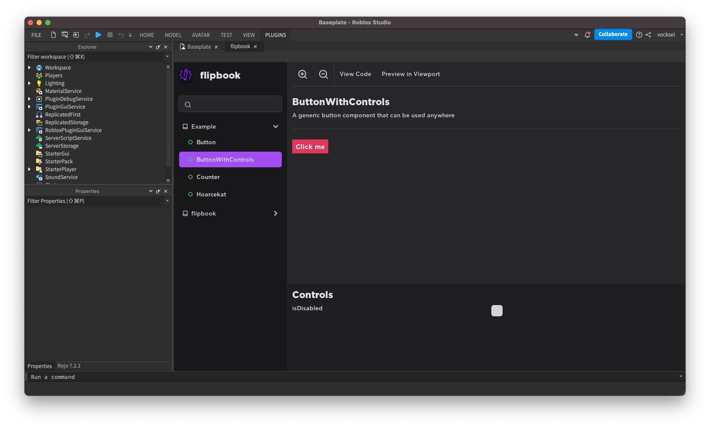

# [Flipbook](https://flipbook-labs.github.io/flipbook)


Flipbook is a storybook plugin for Roblox Studio. It renders each piece of your UI on its own, in a sandbox, so you can work through edge cases and complex states without playing through the whole game. Stories reload as you edit them, and controls let you change their props without touching code.

Guides live at [flipbook-labs.github.io/flipbook](https://flipbook-labs.github.io/flipbook).



## Install

Install Flipbook from the [Creator Store](https://create.roblox.com/store/asset/8517129161/flipbook) to get updates as they're released. Every [release](https://github.com/flipbook-labs/flipbook/releases) also has an `.rbxm` you can copy into Studio's plugins folder.

## Use

1. Add a ModuleScript whose name ends in `.storybook` anywhere in your place. Its `storyRoots` list tells Flipbook where to look for stories.
2. Beside a component, add a ModuleScript whose name ends in `.story` that returns the UI to render.
3. Open Flipbook from the Plugins tab and select the story.

The smallest story returns a plain Instance:

```luau
-- Button.story.luau
return {
	story = function()
		local button = Instance.new("TextButton")
		button.Text = "Click me"
		button.Size = UDim2.fromOffset(200, 40)
		return button
	end,
}
```

See [Writing stories](https://flipbook-labs.github.io/flipbook/docs/creating-stories/writing-stories) for a complete example.

## Frameworks

Flipbook renders plain Roblox Instances by default. Pass your UI library to a storybook or story through `packages` to render React, Roact, or Fusion components. See [Frameworks](https://flipbook-labs.github.io/flipbook/docs/category/frameworks).

## Migrate

Coming from another storybook plugin? Follow the guide for [Hoarcekat](https://flipbook-labs.github.io/flipbook/docs/migration-guides/migrating-hoarcekat) or [UI Labs](https://flipbook-labs.github.io/flipbook/docs/migration-guides/migrating-ui-labs).

## Community

Ask questions and share what you're building in the [Discord thread](https://discord.com/channels/385151591524597761/1063913358740443336/1063913358740443336) or on the [DevForum](https://devforum.roblox.com/t/flipbook-%E2%80%94-storybook-plugin-for-roblox-ui/2184387). Report bugs in [issues](https://github.com/flipbook-labs/flipbook/issues).

## Contributing

See [CONTRIBUTING.md](CONTRIBUTING.md).

## License

MIT.
