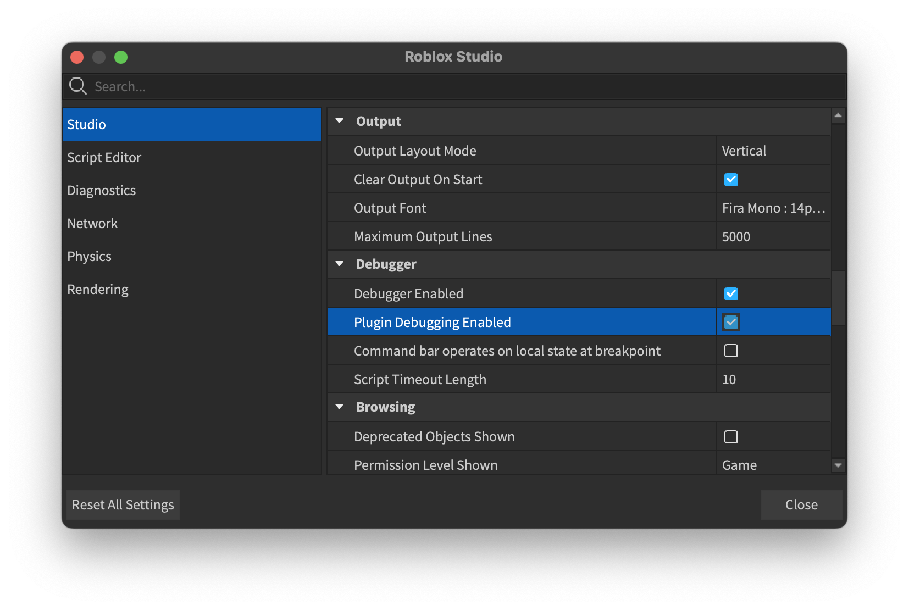

# Onboarding

Thank you for your interest in contributing to Flipbook! This guide walks through setting up a development environment, validating changes, and opening a pull request.

> [!info]
> This guide covers development of the Flipbook plugin. See [Getting Started](../usage/getting-started.md) to learn how to use Flipbook in your own project.

## Fork and Clone the Repository

Start by [forking Flipbook](https://github.com/flipbook-labs/flipbook/fork). Clone your fork, then add the main repository as an `upstream` remote:

```sh
git clone https://github.com/<your-account>/flipbook.git
cd flipbook
git remote add upstream https://github.com/flipbook-labs/flipbook.git
```

Create each contribution from the latest `main` branch:

```sh
git fetch upstream
git switch -c my-change upstream/main
```

## Set Up Your Environment

We use [Visual Studio Code](https://code.visualstudio.com/) to work on Flipbook. The repository includes [recommended extensions](https://github.com/flipbook-labs/flipbook/blob/main/.vscode/extensions.json).

Install [Rokit](https://github.com/rojo-rbx/rokit/), then run these commands from the repository root:

```sh
rokit install
lute run install
cp .env.template .env
```

The checked-in `.env.template` values are enough for builds, linting, and static analysis. Keep `.env` local and never commit credentials.

> [!tip]
> In Visual Studio Code, press `Ctrl+Shift+B` on Windows or `Cmd+Shift+B` on macOS to run the included plugin build task.

## Validate Your Change

Every pull request needs one change entry. Add a Markdown file under [`.changes/`](https://github.com/flipbook-labs/flipbook/blob/main/.changes/README.md) that describes the user-visible effect. Internal-only maintenance uses a patch entry.

Run the repository checks before opening or updating a pull request:

```sh
lute run check
```

This command verifies the branch has a change entry, sets up local type definitions, checks formatting and static analysis, and produces a development plugin build. It does not require an Open Cloud API key.

## Open a Pull Request

Push your branch to your fork, then open a pull request against `flipbook-labs/flipbook:main`.

GitHub runs fork code in jobs that have no repository secrets and only read access. Cloud tests and Storybook preview publishing consume the resulting build artifacts on separate protected runners. Those protected jobs may wait for a maintainer to review the contribution and approve them.

You do not need to request a Flipbook Labs Open Cloud key. If GitHub shows a first-time contributor approval banner or a protected job is waiting, no action is required from you.

## Building

Flipbook's build turns the string requires in its Luau source into the instance requires Roblox runs, and fills in build values such as the version and channel. It does this with [CodeQuality](https://github.com/flipbook-labs/code-quality)'s code mods.

### Build for Studio

The following command builds production Flipbook to your Roblox Studio plugins directory:

```sh
lute run build
```

Open a Baseplate in Studio to start interacting with the plugin.

Production builds prune development files such as unit tests, Storybooks, and Stories. Use the development channel to keep them:

```sh
lute run build --channel dev
```

Add `--watch` to rebuild automatically when files change.

### Build an Rbxm File

Pass `--output` to choose where Flipbook writes the model. For example, this command writes it to the repository root:

```sh
lute run build --output Flipbook.rbxm
```

## Run Cloud Tests Locally

Local cloud tests are optional. They require an Open Cloud API key and test universe that you control, with the corresponding values configured in your local `.env` file:

```sh
lute run test
```

Flipbook uses Roblox's Jest port for unit tests. Existing `.spec.luau` modules show the expected patterns.

## Using Flipbook to Develop Flipbook

Flipbook's React components have Story files, so you can develop the plugin through its own Storybook.

After building Flipbook, open Studio settings and turn on "Plugin Debugging Enabled."



Load a new Baseplate and open Flipbook. Its Storybook appears in the sidebar.

## Writing Documentation

The docs in `docs/obsidian-vault/` are plain Markdown, so you can edit them in any editor, on GitHub, or in [Obsidian](https://obsidian.md) by opening that folder as a vault.

- Link to other pages with relative Markdown links that include the `.md` extension, like `[Controls](../usage/controls.md)`. The site build fails on a link that doesn't resolve, and on Obsidian `[[wikilinks]]`.
- Add notes, tips, and warnings as callouts, like `> [!tip]`. Obsidian, GitHub, and the docs site all render them.
- Each folder's `index.md` lists its pages in the order the sidebar shows them.
- Run `lute run check-docs` before you push. It checks formatting and builds the site, the same as CI.

If you use Obsidian, open Settings -> Files and links, turn off **Use `[[Wikilinks]]`**, and set **New link format** to **Relative path to file**. Obsidian keeps these settings per machine, so the vault can't set them for you.

## Documentation Code Samples

Docs pull real Luau straight from `workspace/code-samples/` using a `code-sample`
fenced block, so examples stay correct:

````md
```code-sample
workspace/code-samples/src/React/ReactButton.luau#L4-L13
```
````

The Docusaurus site expands these at build time. For them to render in the
Obsidian vault, `lute run install` builds a small reading-view plugin into the
vault. Building it needs Node.js, and the install skips it when Node isn't
installed. After your first install, open the vault in Obsidian and enable the
**Code Sample** plugin under Settings -> Community plugins. See
[Architecture](./architecture.md) or the `docs/code-samples/README.md`
for how the marker, the shared extractor, and the two adapters fit together.

## Internal Documentation

For deeper context on architecture, product direction, and in-flight proposals:

**Technical:**

- [Architecture](./architecture.md): Codebase layout and build pipeline details
- [Technical Index](../engineering/index.md): Module Loader, Story Container, Controls, Embedding, and more

**Product:**

- [Northstars](../product/index.md): Product vision and goals
- [2026 Roadmap](../product/2026-roadmap.md): Current quarterly roadmap
- [2025 Product Spec](../product/2025-flipbook-product-spec/index.md): Audiences and feature goals

**Proposals:**

- [Story Renderer Spec](../engineering/proposals/story-renderer-spec.md) _(In Progress)_
- [Storyteller API](../engineering/proposals/storyteller-api.md) _(In Progress)_
- [Story and Storybook Typechecking](../engineering/proposals/story-storybook-typechecking.md) _(In Progress)_
- [Documentation Stories](../engineering/proposals/documentation-stories.md) _(Approved)_
- [Modular Story Format](../engineering/proposals/modular-story-format.md)
- [Flipbook Package](../engineering/proposals/create-flipbook-package.md)

**Ideas:**

- [Ideas Index](../product/ideas/index.md): Toolbar, Storybook Selection UX, Right-click Context Menu
