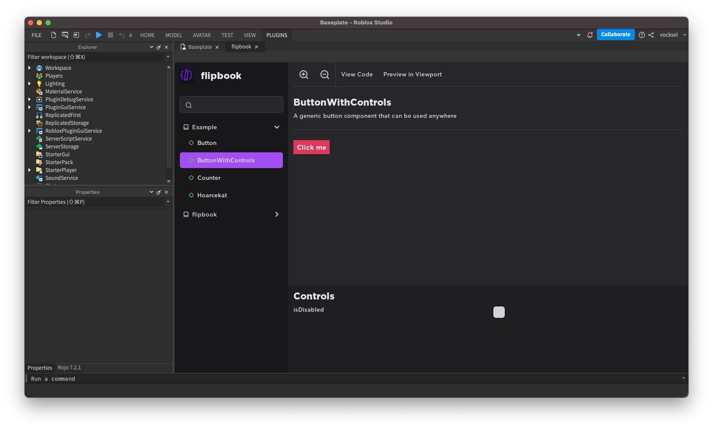
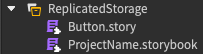
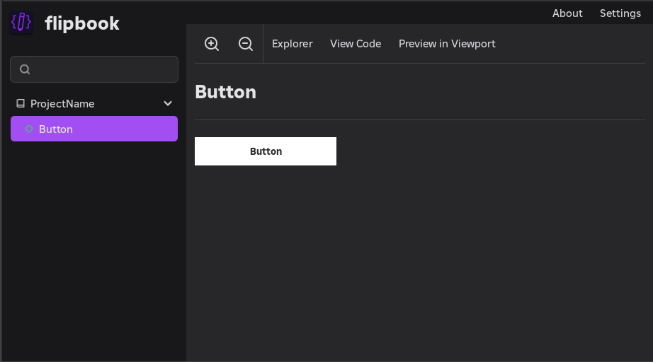

# Getting Started

Flipbook is a storybook plugin that renders your UI components in a sandboxed canvas, isolated from the rest of your game. Instead of navigating a complex interface just to reach the one surface you want to work on, and then wrangling it into each state by hand, you preview that surface on its own and switch between its variations with controls.

It works with however you build UI. Out of the box Flipbook renders plain Roblox Instances with no setup, and it has native support for [React](./frameworks/react.md), [Fusion](./frameworks/fusion.md), and [Roact](./frameworks/roact.md). You can also share a live preview with your whole team, designers included, straight from a place via [deployed storybooks](./deploying-storybooks.md).

<!-- capture {
  "asset": "assets/main-screenshot.png",
  "kind": "plugin",
  "story": "workspace/code-samples/src/React/ReactButtonControls.story.luau",
  "setup": ["open the story so the sidebar, canvas, and controls panel are all populated"],
  "frame": "plugin-window",
  "theme": "dark",
  "alt": "The Flipbook plugin rendering a story"
} -->



## Installation

All you need is Roblox Studio and a place to work in. The walkthrough below creates two ModuleScripts; if you manage your project with [Rojo](https://github.com/rojo-rbx/rojo/), create them as `.luau` files in your source tree instead and they sync in the same way.

Install Flipbook from the [Creator Store](https://create.roblox.com/store/asset/8517129161/flipbook) to get automatic updates as new versions ship.

[](https://create.roblox.com/store/asset/8517129161/flipbook)

> [!tip]
> A [development build](https://create.roblox.com/store/asset/88523969718241/Flipbook-Dev) tracks the `main` branch if you want features early (expect the occasional bug). You can also download an `rbxm` from the [GitHub Releases](https://github.com/flipbook-labs/flipbook/releases) page and copy it into your local plugins folder.

## Create Your First Story

Flipbook needs two things to render something: a [Storybook](../concepts/storybook.md) that tells it where your stories are, and a [Story](../concepts/story.md) that renders a single component.

Start with the Storybook. It can live anywhere in the experience. The only requirement is a `storyRoots` array pointing at the instances whose descendants Flipbook should search for stories:

```code-sample
workspace/code-samples/src/Default/ProjectName.storybook.luau
```

Then add a Story next to the component it renders. This one builds a `TextButton` with the default renderer, so no UI library is needed:

```code-sample
workspace/code-samples/src/Default/Button.story.luau
```

To connect these back to Studio, store them as ModuleScripts, for example under ReplicatedStorage:

<!-- capture {
  "asset": "assets/storybook-setup.png",
  "kind": "studio",
  "story": "workspace/code-samples/src/Default/Button.story.luau",
  "setup": ["place ProjectName.storybook and Button.story ModuleScripts under ReplicatedStorage", "screenshot the Explorer tree showing them"],
  "frame": "plugin-window",
  "theme": "dark",
  "alt": "The Studio Explorer showing the Storybook and Story ModuleScripts under ReplicatedStorage"
} -->



Open Flipbook, select the Button story, and it renders into the canvas. It's already interactive, so click it and watch the output:

<!-- capture {
  "asset": "assets/first-story.png",
  "kind": "story",
  "story": "workspace/code-samples/src/Default/Button.story.luau",
  "setup": ["select the Button story in the sidebar", "click the rendered button so its output prints"],
  "frame": "canvas",
  "theme": "dark",
  "alt": "The Button story rendered in the canvas"
} -->



Editing the Story live-reloads the preview, so you can shape the button and see the result immediately.

## Next Steps

- [The Flipbook Interface](./the-flipbook-interface.md): a tour of the sidebar, canvas, topbar, and settings you just used.
- [Controls](./controls.md): change a story's behavior on the fly, swapping variations and toggling states without touching code.
- [Writing Stories](./writing-stories.md): the different ways to define a Story, and how to render one with your UI framework.
- [Frameworks](./frameworks/index.md): complete Storybook and Story examples for React, Fusion, and Roact.
